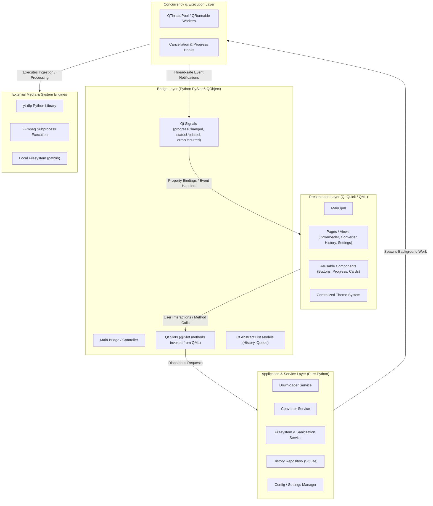
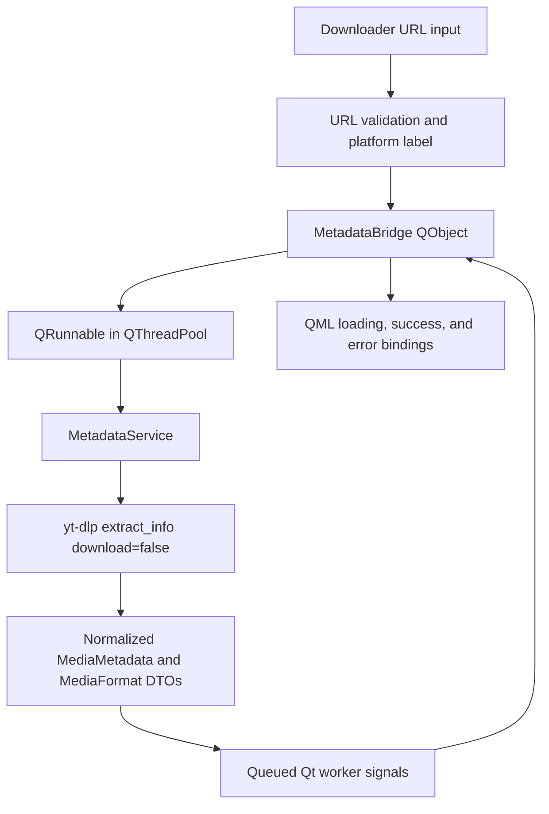

# MediaForge — System Architecture

## Architecture Overview

MediaForge enforces a strict **layered architecture** with unidirectional data flow and clear boundaries between visual presentation, bridge adaptation, application business logic, and low-level system engines.

---

## Separation of Concerns

### 1. Presentation Layer (`qml/`)
- **Responsibilities**:
  - Declarative visual layout, typography, animations, color palette application.
  - User interaction capture (clicks, inputs, drag-and-drop gestures).
  - Binding to bridge properties (e.g., download progress percentage, status text).
  - Responsive visual states (idle, active, paused, failed, completed).
- **Strict Invariants**:
  - **No business logic**: QML never calculates bitrates, never touches subprocesses, and never directly accesses the filesystem or network.
  - **No hardcoded theme tokens**: All dimensions, colors, and typography reference a centralized theme object.

### 2. Bridge Layer (`src/bridge/`)
- **Responsibilities**:
  - Inherits from `QObject` to expose Python objects to the QML JavaScript runtime engine.
  - Declares `@Property`, `@Signal`, and `@Slot` decorators.
  - Converts primitive data between Python native types (dicts, dataclasses, lists) and QML-compatible `QVariant` types.
  - Marshals background worker events onto the main Qt event loop before triggering signals that touch UI components.
  - `MetadataBridge` validates requests, schedules metadata work, and exposes loading, success, error, and normalized metadata properties to QML.

### 3. Application & Service Layer (`src/backend/`)
- **Responsibilities**:
  - Encapsulates pure business logic independent of any GUI framework.
  - Can be unit-tested without launching a Qt GUI application or QML engine.
  - The Phase 4 `downloader` package contains URL validation, platform labeling, yt-dlp metadata extraction, normalization, and domain DTOs. It does not download media.
  - Submodules:
    - `downloader`: Interacts with yt-dlp API; handles URL validation, format mapping, metadata parsing.
    - `converter`: Manages FFmpeg process execution, parameter generation, output streams.
    - `filesystem`: Sanitizes file names, prevents path traversal, resolves collisions, ensures directories exist.
    - `history`: SQLite schema management, insert/query of conversion and download logs.
    - `config`: Reads and writes user preferences in JSON format.
    - `logging`: Unified, structured application logging across all components.

### 4. External Engines & System Layer
- **yt-dlp**: In-memory metadata extraction via `extract_info(url, download=False)` and hook-based media streaming.
- **FFmpeg**: Streamlined, secure execution using `subprocess.Popen` / `subprocess.run` with discrete argument lists (`argv`) rather than raw shell strings (`shell=False`).
- **Pathlib**: Strict OS-agnostic path management.

---

## Phase 4 Metadata Pipeline

- `validate_media_url` trims input, requires an absolute HTTP(S) URL, and returns a structured result. Platform recognition (YouTube, Instagram, Pinterest, or Unknown) is display metadata only; yt-dlp determines actual extraction support.
- `MetadataService` uses the embedded yt-dlp Python API with `extract_info(url, download=False)`, `skip_download`, and single-item options. It does not parse CLI output or start a download.
- `normalize_metadata` converts the variable extractor mapping to frozen application DTOs, classifies video/audio/combined formats, and builds unique descending quality labels. The raw extractor mapping never crosses the bridge.
- `MetadataBridge` validates before queueing, rejects duplicate requests while busy, and receives queued worker outcomes on the GUI thread. QML only binds to its properties; the worker never manipulates QML items.
- User-facing error messages are mapped to stable categories. Technical exception details are logged separately and are not sent to QML.
- The application-level `formats` list contains normalized format descriptors, not direct media stream URLs.

## Concurrency & Threading Model

A critical rule of GUI desktop development:
> **The GUI / Main Thread must never be blocked by I/O, network requests, or CPU-heavy processing.**

- **The Main Thread**: Runs the Qt Event Loop (`app.exec()`). It processes user input, repaints dirty frames at 60+ FPS, and processes queued signals.
- **Worker Runnables**: All network fetching (yt-dlp metadata and downloads) and audio/video transcoding (FFmpeg subprocess monitoring) run inside managed worker threads.
- **Inter-Thread Communication**: Workers communicate back to the bridge via Qt Signals. Because Qt signals use queued connections across thread boundaries, event payloads are safely posted to the main thread's event loop.

---

## Fundamental Media Processing Concepts

| Concept | Explanation | Real-World Context |
|---|---|---|
| **Container** | A wrapper file format that bundles one or more media streams (video, audio, subtitles) and metadata into a single file. | `.mp4`, `.mov`, `.mkv`, `.webm` |
| **Codec** | The algorithm/compression format used to encode and decode actual raw audio or video frames. | Video: H.264 (AVC), H.265 (HEVC), VP9, AV1. Audio: AAC, MP3, Opus, FLAC. |
| **Remuxing** | Changing the container format without re-encoding the underlying audio or video data streams (e.g. copying streams from `.mkv` to `.mp4`). | Lightning-fast; zero quality loss; virtually no CPU overhead (`ffmpeg -c copy`). |
| **Transcoding** | Decoding an existing compressed stream back to raw uncompressed data and re-encoding it using a different codec or bitrate. | CPU/GPU intensive; takes time; lossy if using lossy codecs (e.g., converting H.264 to VP9 or AAC to MP3). |
| **Bitrate** | Amount of data processed per unit of time (e.g., kbps or Mbps). Higher bitrate generally means higher fidelity at the cost of file size. | Video: 5,000–25,000 kbps. Audio: 128–320 kbps. |
